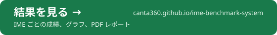

<p align="center">
  
</p>

<p align="center">
  Windows の日本語入力（IME）の精度を測るオープンなベンチマークです。<br>
  日本語、英語、英語まじりの日本語を、どの IME にも同じ手順で打って比べます。<br>
  出力も判定も全部公開しています。
</p>

<p align="center">
  <a href="https://canta360.github.io/ime-benchmark-system/"></a>
</p>

<p align="center">
  <a href="README.md">English</a> ·
  <a href="#測り方">測り方</a> ·
  <a href="#結果ページ">結果ページ</a> ·
  <a href="#結果の共有">結果の共有</a> ·
  <a href="#方針">方針</a> ·
  <a href="https://capitata.dev">capitata.dev</a>
</p>

計測アプリ（`runner/ImeBench.exe`）は、文ごとのローマ字を自分の入力欄に打ち込み、モードに合わせて確定して、入った文字を記録します。確定は Space のあと Enter か、Enter だけ。IME の中身には触らず、どの IME が動いているかを読むだけなので、TSF 対応の IME なら何でも測れます。

測るのは次の 3 種類です。

- **日本語**：区切らずに打ったローマ字
- **英語**：打ち間違いのある英文とない英文（英語を自動で直す IME 向け）
- **英語まじりの日本語**：英単語の前後にスペースを入れる打ち方と、続けて打つ打ち方

## セット

| テスト | 内容 | 数 | 出典・ライセンス |
|---|---|---|---|
| AJIMEE | AJIMEE-Bench の全問。中身はそのままで、ローマ字のキーだけ追加 | 200 | azooKey/AJIMEE-Bench、CC BY-SA 3.0 |
| MOZC | Mozc の評価データのうち、変換結果が 1 つに決まる行 | 296 | google/mozc、BSD-3-Clause |
| JA | 日本語の文（短文から長文まで） | 998 | 本ベンチマーク |
| JA-SLIP | JA の各文に打ち間違いを 2 か所入れたもの | 998 | 本ベンチマーク |
| MIX-SP | 英語まじりの日本語。英単語の前後をスペースで区切る | 499 | 本ベンチマーク |
| MIX-RUN | MIX-SP と同じ文を区切らずに打つ | 499 | 本ベンチマーク |
| EN | 英文 | 498 | 本ベンチマーク |
| EN-SLIP | EN の各文に打ち間違いを 2 か所入れたもの | 498 | 本ベンチマーク |
| POST-JA | SNS の投稿のような文章（日本語） | 100 件（254 文） | 本ベンチマーク |
| POST-MIX-SP、POST-MIX-RUN | 英語まじりの投稿（区切りあり・なし） | 各 100 件（237 文） | 本ベンチマーク |
| POST-EN、POST-EN-SLIP | 英語の投稿（打ち間違いなし・あり。ありは 1 件に 2 か所） | 各 100 件 | 本ベンチマーク |

数は採点に使う文の数です。キーがまったく同じ行は 1 回だけ数えます（MOZC と MIX で 1 行ずつ）。投稿は文ごとに打って採点します。

本ベンチマークのセットは、held-out サイクル c1 に同じ作り方の文を足したものです。c1 は `heldout/c1/` にそのまま置いてあり、`heldout/c1_commitments.txt` のハッシュと照合できます。いま使っている held-out は c2 で、テストの種類も数もほぼ同じです。

held-out は、IME を調整する人がまだ見ていない文です。

1. サイクルごとに Claude Sonnet 5.5 が新しく書きます。人が実際に打ちそうな文で、既存のコーパスは使いません。読みは Claude Opus 5.5 が全部見直し、ローマ字のキーと合うかをスクリプトで確かめます。
2. 結果より先に、全ファイルの SHA-256 を公開します（`heldout/cN_commitments.txt`）。
3. サイクルが終わったら中身を公開し、公開セットに移します。

## 判定

意図した文と違う出力でも、間違いとは限りません。「後で」と「あとで」は同じ文ですし、短い文なら同音異義語でも自然に読めることがあります。そこで違う出力は、言語モデルに文全体を読ませて判定しています。見せるのは意図した文と出力だけで、IME 名は伏せます（`JUDGE.md`）。

- **A**：言葉は同じで、表記だけ違う（漢字とかな、送りがな、全角と半角、大文字と小文字）
- **B**：言葉は違うが、文として自然に読める
- **C**：読めば気づく誤り

判定は（意図した文、出力）の組ごとに 1 回だけ。結果は `labels.tsv` にあります。同じ 200 件を Claude Opus 5.5 と Claude Sonnet 5.5 に判定させたところ、98.5% が一致しました（Cohen's kappa 0.94）。ふだんの判定は Sonnet です。

## 指標

- **文**：完全一致率、**fair %**（完全一致と A の合計）、+B %、文字誤り率（CER）。どれも 95% 信頼区間（Wilson）付き
- **AJIMEE**：AJIMEE-Bench 公式の acc@1 と MinCER
- **投稿**：全体が正しい投稿の割合、**投稿 1 件あたりの直す箇所の数**、CER
- **英語**：正しい文の割合、直せた打ち間違いの数、正しかったのに変えてしまった単語の数
- **比較**：同じ文で 2 つの IME を比べる McNemar 検定（正確検定）。p ≥ 0.05 なら差なし

## 測り方

1. Releases から `ImeBench.exe` を落として `runner\` に置きます。自分でビルドするなら、次を一度実行するだけです。コンパイラは Windows に最初から入っています。

   ```powershell
   & "$env:WINDIR\Microsoft.NET\Framework64\v4.0.30319\csc.exe" -nologo -target:winexe -win32icon:runner\icon\app.ico -r:System.Drawing.dll -out:runner\ImeBench.exe runner\ImeBench.cs runner\ImeBenchApp.cs
   ```

2. `runner\ImeBench.exe` を起動し、入力欄をクリックします。そこで、いつもの方法（Win+Space など）で測りたい IME とモードに切り替えます。
3. セット、モード、学習の ON/OFF を選んで **測定開始**。最初の 3 文がローマ字のまま残ったら、計測を止めて知らせます。

計測中は、残りの文の数と残り時間が出ます。マウスかキーに触ると一時停止し、5 秒止まると続きから再開します。触っている間に打っていた文は、最初から打ち直します。

画面は日本語と英語で切り替えられます。結果は `results/<日時>-<名前>-<モード>/` に入ります。

- `out/`：出力
- `meta.json`：Windows のビルド、IME の DLL とバージョン、モード、学習の設定、セットの SHA-256、アプリのハッシュ
- `times/`：文ごとの打ち始めと打ち終わりの時刻
- `manifest.sha256`：全ファイルのハッシュ

確認と採点はこの 2 行です。

```powershell
python tools\bench.py check results\<結果フォルダ>
python tools\bench.py score results\<結果フォルダ>
```

`runner\realime.ps1` は、画面なしで複数の IME をまとめて測るメンテナー用のスクリプトです。

## 結果ページ

push するたびに、`tools/site.py` が[結果ページ](https://canta360.github.io/ime-benchmark-system/)（GitHub Pages、日本語と英語）を作り直します。

- テキストの種類（日本語、英語まじり、英語）ごとの順位。95% 信頼区間と、1 位と差がないかの判定つき
- セットごとの点数のドットプロット
- IME ごとの総評ページ。数字から自動で書いた要点、得意・不得意、その IME だけが間違えた文の例
- 全組み合わせの McNemar 検定と、文ごとの出力

`--pdf` を付けると、Chrome か Edge で A4 縦の PDF を作ります。

| PDF | 中身 |
|---|---|
| `report-summary.ja.pdf` | 要約（1 枚） |
| `report-full.ja.pdf` | 全セットの詳細 |
| `report.<IME>.ja.pdf` | IME ごとの総評（1 枚） |

英語版は `.en.pdf` です。どれも計測の日時と環境を載せています。

## 結果の共有

手順は [CONTRIBUTING_JP.md](CONTRIBUTING_JP.md) にまとめました。

大まかには、測った結果フォルダを手を加えずに `results/` に入れ、プルリクエストを送るだけです。アプリの **結果を提出** を押すと、手順が出て、GitHub のアップロード画面が開きます。GitHub Actions が中身を検査し、生の出力から採点し直します。検査するのは、セットの全行が 1 回ずつあるか、セットのハッシュが合うか、必要な情報がそろっているか。公開している版のアプリで測ったか、計測のあとにファイルが書き換えられていないか、各文が実際に打てる時間をかけて打たれたかも確かめます。提出された点数は使いません。

まだ判定していない出力は、メンテナーが判定して `labels.tsv` に足します。メンテナーが測った結果と、メンテナーが同じ IME の同じ版で一部の文を測り直して出力が一致した結果を **verified**、それ以外を **community** と表示します。

## 今後の予定

- 前の文脈つきの AJIMEE-Bench。プログラムで入力欄に入れた文脈を、計測した IME はどれも読んでいませんでした。今は文脈なしで測っています。
- 入力中に見えるライブ変換の評価。英語まじりでのライブ変換も
- 英語まじり入力で 1 文字あたり何回キーを押したか（モード切り替えも数える）
- 学習 OFF を主な条件にする

## 方針

IME精度測定は、TEKITO という IME を開発している Capitata が作っています。測られる側が作ったベンチマークを、そのまま信用してもらえるとは考えていません。だから、誰でも確かめられる形にしました。

- **TEKITO の宣伝のためのものではありません。** TEKITO が負けた結果も、ここで見つかった TEKITO の不具合も載せます。
- **テストに合わせた調整はしません。** TEKITO の開発者が見られるのは held-out の点数だけ。文も出力も見ません。held-out の文は、ハッシュで TEKITO の学習データから取り除いています。評価も TEKITO の開発とは別に行っています。
- **条件はどの IME も同じです。** TEKITO も含め、同じプログラムで同じキーを打ちます。測るのは公開済みの版だけで、比較に使うのもその結果だけです。
- **全部公開しています。** コード、セット、生の出力、判定、held-out のハッシュ。誰でも全結果を採点し直せます。
- **参加は誰でも歓迎します。** 結果の提出も、セットや測り方の提案も、プルリクエストで受け付けます。採点方法を変えるときは、理由を書いたうえで公開の場で変えます。

## ライセンス

コード（`runner/`、`tools/`、`.github/`）のライセンスは Apache License 2.0（`LICENSE`）です。データはそれぞれのライセンスに従います。

| データ | ライセンス |
|---|---|
| `sets/ajimee.*` | CC BY-SA 3.0。azooKey/AJIMEE-Bench（コミット 401666cd）。日本語 Wikipedia 入力誤りデータセット v2 に基づく。ローマ字のキーを追加 |
| `sets/mozc.tsv` | BSD-3-Clause。google/mozc の `evaluation.tsv`（コミット b9c3fcbd）。ローマ字のキーを追加 |
| held-out の文、`results/`、`labels.tsv` | CC BY 4.0 |
| `assets/`、`runner/icon/`（ロゴ、アイコン） | 権利は Capitata にあります |

ロゴの文字は [851ゴチカクット](https://pm85122.onamae.jp/851Gkktt.html)（「試」）と [f.k 機械彫刻](https://font.kim/)（「IME精度測定」）をアウトライン化したものです。結果ページのデザインは、デジタル庁デザインシステムを使っています。

IME精度測定は [Capitata](https://capitata.dev) が開発しています。

<p align="center">
  <a href="https://capitata.dev">
    <picture>
      <source media="(prefers-color-scheme: dark)" srcset="assets/capitata-dark.png">
      
    </picture>
  </a>
</p>
