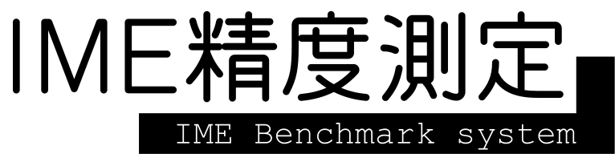

<p align="center">
  
</p>

<p align="center">
  Windows の日本語入力（IME）の精度を測る、オープンなベンチマークです。<br>
  日本語・英語・英語まじりの日本語を、すべての IME に同じ手順で入力して比べます。<br>
  出力と判定はすべて公開しています。
</p>

<p align="center">
  <a href="README.md">English</a> ·
  <a href="#方針">方針</a> ·
  <a href="#測り方">測り方</a> ·
  <a href="#結果ページ">結果ページ</a> ·
  <a href="#結果の共有">結果の共有</a> ·
  <a href="https://capitata.dev">capitata.dev</a>
</p>

計測用の小さな Windows アプリ（`runner/ImeBench.exe`）が、各文のローマ字を自分の入力欄に打ち込み、モードに応じて確定（Space のあと Enter、または Enter のみ）して、入力された文字を記録します。IME の内部には触れず、使っている IME が何かを読み取るだけなので、TSF に対応した IME ならどれでも測れます。

測る内容は次の 3 つです。

- **日本語**：区切らずに打ったローマ字
- **英語**：打ち間違いを含む英文と含まない英文（英語の自動修正を持つ IME 向け）
- **英語まじりの日本語**：英単語の前後をスペースで区切った打ち方と、区切らずに続けた打ち方

## 方針

IME精度測定は、TEKITO という IME を開発している Capitata が作っています。測られる側が作ったベンチマークは疑われて当然です。そこで、信頼してもらうのではなく、誰でも確かめられるように作っています。

- **見せるためではなく、測るため。** IME の実力を知るためのものです。TEKITO が負けている結果や、見つかった TEKITO の不具合もそのまま載せます。
- **テストに合わせた調整はしない。** TEKITO の開発者が見られるのは held-out の点数だけで、文や出力は見ません。held-out の文は、ハッシュを使って TEKITO の学習データから除いています。評価は TEKITO の開発と切り離して行います。
- **すべての IME を同じ条件で。** TEKITO を含むすべての IME を、同じプログラムで同じキーを打って測ります。測るのは一般に公開されている版だけで、比較に使うのもこの計測だけです。
- **すべて確かめられる。** コード、セット、生の出力、すべての判定、held-out のハッシュを公開しています。誰でもすべての結果を採点し直せます。
- **誰でも参加できる。** 結果の提出や、セット・測り方の改善提案はプルリクエストで受け付けます。採点方法を変えるときは、理由を添えて公開の場で変更します。

## セット

| テスト | 内容 | 数 | 出典・ライセンス |
|---|---|---|---|
| AJIMEE | AJIMEE-Bench の全問を公開どおりに使用（ローマ字のキーのみ追加） | 200 | azooKey/AJIMEE-Bench、CC BY-SA 3.0 |
| MOZC | Mozc の評価データのうち、変換結果が 1 つに決まる行 | 297 | google/mozc、BSD-3-Clause |
| JA | 日本語の文（短文から長文まで） | 998 | 本ベンチマーク |
| JA-SLIP | JA の各文に打ち間違いを 2 か所入れたもの | 998 | 本ベンチマーク |
| MIX-SP | 英語まじりの日本語（英単語の前後をスペースで区切る） | 500 | 本ベンチマーク |
| MIX-RUN | MIX-SP と同じ文を区切らずに打つ | 500 | 本ベンチマーク |
| EN | 英文 | 498 | 本ベンチマーク |
| EN-SLIP | EN の各文に打ち間違いを 2 か所入れたもの | 498 | 本ベンチマーク |
| POST-JA | SNS の投稿のような文章（日本語） | 100 | 本ベンチマーク |
| POST-MIX-SP、POST-MIX-RUN | 英語まじりの投稿（区切りあり・なし） | 各 100 | 本ベンチマーク |
| POST-EN、POST-EN-SLIP | 英語の投稿（打ち間違いなし・あり） | 各 100 | 本ベンチマーク |

本ベンチマーク用のセットは、held-out サイクル c1 に、同じ方法で書いた文を加えて増やしたものです。c1 は `heldout/c1/` に手を加えずに公開しており、`heldout/c1_commitments.txt` のハッシュと一致します。現在の held-out サイクル c2 も、同じ種類のテストをほぼ同じ数だけ持っています。

**held-out セット**は、IME を調整する人が見たことのない文です。数字の公正さを保つために使います。

1. サイクルごとに Claude Sonnet 5.5 が新しく書きます。人が実際に打つような自然な文で、既存のコーパスは使いません。読みはすべて Claude Opus 5.5 が校正し、ローマ字のキーと一致することをスクリプトで確かめます。
2. 結果を出す前に、すべてのファイルの SHA-256 を公開します（`heldout/cN_commitments.txt`）。
3. サイクルを終えたら中身を公開し、公開セットにします。

TEKITO の開発者が見られるのは held-out の点数だけです。学習データからの除外もハッシュで行います。

## 判定

意図した文と違う出力が、いつも間違いとは限りません。「後で」と「あとで」のような表記の違いや、文に合う同音異義語などがあるためです。そこで、意図した文と出力だけを、IME 名を伏せて言語モデルに見せ、文全体として判定させます（`JUDGE.md`）。

- **A**：同じ言葉で、表記だけが違う（漢字とかな、送りがな、全角と半角、大文字と小文字）
- **B**：違う言葉だが、文として自然に読める
- **C**：読んだ人が気づく誤り

判定は（意図した文、出力）の組ごとに 1 回だけ行い、`labels.tsv` で公開しています。同じ 200 件を Claude Opus 5.5 と Claude Sonnet 5.5 がそれぞれ判定したところ、98.5% が一致しました（Cohen's kappa 0.94）。通常の判定には Sonnet を使います。

## 指標

- **文**：完全一致率、**fair %**（完全一致と A の合計）、+B %、文字誤り率（CER）。いずれも 95% 信頼区間（Wilson）付き
- **AJIMEE**：AJIMEE-Bench 公式の acc@1 と MinCER
- **投稿**：全体が正しい投稿の割合、**投稿 1 件あたりの修正箇所数**、CER
- **英語**：正しい文の割合、直せた打ち間違いの数、誤って変えてしまった正しい単語の数
- **比較**：同じ文での McNemar 検定（正確検定）。p ≥ 0.05 のときは差なしとします

## 測り方

1. Releases から `ImeBench.exe` をダウンロードして `runner\` に置きます。自分でビルドする場合は、次のコマンドを一度だけ実行します（コンパイラは Windows に標準で入っています）。

   ```powershell
   & "$env:WINDIR\Microsoft.NET\Framework64\v4.0.30319\csc.exe" -nologo -target:winexe -win32icon:runner\icon\app.ico -r:System.Drawing.dll -out:runner\ImeBench.exe runner\ImeBench.cs runner\ImeBenchApp.cs
   ```

2. `runner\ImeBench.exe` を起動し、入力欄をクリックしてから、いつもの方法（Win+Space など）で測りたい IME とモードに切り替えます。
3. セット、モード、学習の ON/OFF を選び、**測定開始** を押します。進捗バーが終わるまで PC には触らないでください。最初の 3 文がローマ字のまま変換されない場合は、計測を止めてお知らせします。

画面は日本語と英語を切り替えられます。結果は `results/<日時>-<名前>-<モード>/` に保存され、出力と `meta.json`（Windows のビルド、IME の DLL とバージョン、モード、学習の設定、セットの SHA-256、アプリのハッシュ）が入ります。続けて次を実行します。

```powershell
python tools\bench.py check results\<結果フォルダ>
python tools\bench.py score results\<結果フォルダ>
```

`runner\realime.ps1` は、画面を使わずに複数の IME をまとめて測るためのメンテナー用スクリプトです。

## 結果ページ

push のたびに `tools/site.py` が結果ページ（GitHub Pages、日本語と英語）を作成します。fair % と 95% 信頼区間、すべての組み合わせでの McNemar 検定、文ごとの出力を掲載しています。`--pdf` を付けると、Chrome または Edge を使って A4 のレポート（`report.ja.pdf`、`report.en.pdf`）も作成します。

## 結果の共有

詳しい手順は [CONTRIBUTING_JP.md](CONTRIBUTING_JP.md) にあります。

測定した結果フォルダを編集せずに `results/` に入れ、プルリクエストを送ってください。GitHub Actions が内容を検査し（セットの全行が 1 回ずつ含まれているか、セットのハッシュ、必要な情報がそろっているか）、生の出力から採点し直します。提出に書かれた点数は使いません。まだ判定されていない出力はメンテナーが判定し、`labels.tsv` に追加します。結果ページでは、メンテナーが測った結果を **verified**、それ以外を **community** と表示します。

## 今後の予定

- 前の文脈を含めた AJIMEE-Bench。プログラムで入力欄に入れた文脈を、計測した IME が読み取らなかったため、現在は文脈なしで測っています。
- 入力中に表示されるライブ変換の評価と、英語まじり入力でのライブ変換
- 英語まじり入力での 1 文字あたりのキー数（モード切り替えの操作も含める）
- 学習 OFF を主な計測条件にする

## ライセンス

コード（`runner/`、`tools/`、`.github/`）は Apache License 2.0（`LICENSE`）で公開しています。データはそれぞれのライセンスに従います。

| データ | ライセンス |
|---|---|
| `sets/ajimee.*` | CC BY-SA 3.0。azooKey/AJIMEE-Bench（コミット 401666cd）。日本語 Wikipedia 入力誤りデータセット v2 に基づく。ローマ字のキーを追加 |
| `sets/mozc.tsv` | BSD-3-Clause。google/mozc の `evaluation.tsv`（コミット b9c3fcbd）。ローマ字のキーを追加 |
| held-out の文、`results/`、`labels.tsv` | CC BY 4.0 |
| `assets/`、`runner/icon/`（ロゴ、アイコン） | 権利は Capitata が保有 |

ロゴの文字には [851ゴチカクット](https://pm85122.onamae.jp/851fontpage.html)（「試」）と [f.k 機械彫刻](https://font.kim/)（「IME精度測定」）を使い、アウトライン化しています。結果ページのデザインには、デジタル庁デザインシステムを使用しています。

IME精度測定は [Capitata](https://capitata.dev) が開発しています。

<p align="center">
  <a href="https://capitata.dev">
    <picture>
      <source media="(prefers-color-scheme: dark)" srcset="assets/capitata-dark.png">
      
    </picture>
  </a>
</p>
